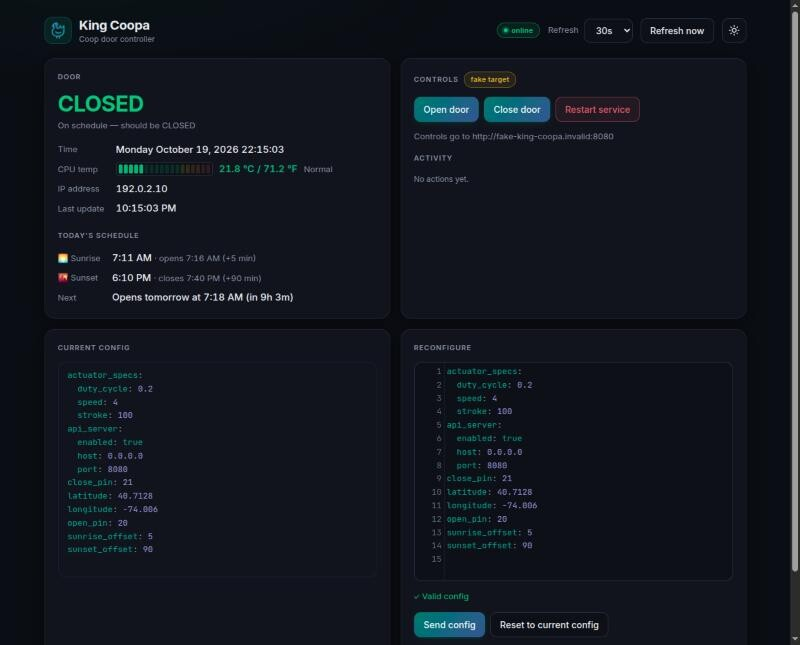

# King Coopa Dashboard

A small web dashboard for the [King Coopa](../README.md) chicken-coop door controller. It shows the door's live state and the Pi's health, works out today's open/close times the same way the controller does, and lets you open, close, restart, or reconfigure the door with safety checks.



*Screenshot uses a placeholder IP (`192.0.2.10`) and example coordinates (New York City).*

## Features

- **Live status**, polled from the controller's `GET /info` (every 30 s by default; 10 s / 60 s / 5 m / off):
  - door state, colored by whether it matches the schedule: **green** on schedule, **amber** while moving or within 3 minutes of a scheduled change, **flashing red** (plus a ⚠ in the tab title) when it's open/closed when it shouldn't be
  - Pi clock, IP address, last update
  - CPU temperature as a segmented bar in °C and °F, with zones for the Pi Zero W (BCM2835): normal < 60, warm 60–70, hot 70–80, too hot ≥ 80 (firmware throttling)
- **Today's schedule**: sunrise/sunset and the resulting open/close times (sunrise + `sunrise_offset`, sunset + `sunset_offset`) with a countdown. This is a line-for-line port of `suntime` 1.2.5, the library the controller uses. It was checked against the library for every day of a year, to the minute.
- **Controls**: Open, Close, Restart. Each one shows a confirmation with the target, the last known door state and how old that reading is, plus warnings (for example, the door is already closed or currently moving). Every action, including sending a config, needs a confirmation checkbox ticked first.
- **Reconfigure**: a YAML editor prefilled from the live config, with lint-as-you-type (syntax, required keys, types, ranges, duplicate pins, `api_server` block). Send is blocked while there are errors, and the confirmation shows a key-by-key diff.
- **Current config**: the live config as read-only, highlighted YAML.
- **`/status` endpoint** for Homepage and Uptime Kuma, plus a Docker `HEALTHCHECK`.
- **Dark theme by default**, with a light/dark toggle that each browser remembers.

## How it works

```
browser ──► dashboard (server.py, :8090) ──► King Coopa API on the Pi (:8080)
             ├─ serves static/index.html
             ├─ GET  /api/info          → KC_INFO_URL/info
             └─ PUT  /api/open|close|restart
                POST /api/reconfigure   → KC_CONTROL_URL/...
```

`server.py` is a dependency-free Python proxy. It exists because the controller's Flask API sends no CORS headers, so a browser can't call it directly. It also lets **info** and **controls** point at different hosts. Until you're ready, keep controls pointed at a fake `.invalid` host so the buttons can't move the real door.

The page loads CodeMirror, js-yaml and Google Fonts from public CDNs, so the browser viewing it needs internet access.

## Configuration

All settings are environment variables. For local runs they can also live in `dashboard/.env`, which is gitignored; real environment variables take precedence.

| Variable | Required | Default | Purpose |
|---|---|---|---|
| `KC_INFO_URL` | **yes** | — | King Coopa API used for live info, e.g. `http://<pi-address>:8080`. The server won't start without it. |
| `KC_CONTROL_URL` | no | `http://fake-king-coopa.invalid:8080` | Where open, close, restart and reconfigure go. Set it to the same value as `KC_INFO_URL` to make the controls live. In Docker it's also a build arg (`--build-arg KC_CONTROL_URL=...`) that sets the image's default; a runtime `-e` or stack variable overrides it. |
| `PORT` | no | `8090` | Port the dashboard listens on. |
| `BIND` | no | `0.0.0.0` | Interface to listen on. Use `127.0.0.1` for local-only. |
| `KC_TIMEOUT` | no | `10` | Upstream request timeout, in seconds. |

Both URLs must be `http://` or `https://`; the server refuses to start otherwise. The Controls card shows a **fake target** badge while `KC_CONTROL_URL` is a `.invalid` host.

## Setup

### Option A: Portainer stack (recommended)

1. **Stacks → Add stack → Repository**.
2. Repository URL: `https://github.com/chrisdimaio/king-coopa`.
3. Repository reference: `refs/heads/dashboard`.
4. Compose path: `dashboard/docker-compose.yml`.
5. Under **Environment variables**, add `KC_INFO_URL` = `http://<pi-address>:8080`. To go live later, also add `KC_CONTROL_URL`.
6. Deploy, then open `http://<docker-host>:8090`.

The compose file builds the image from `dashboard/Dockerfile` and refuses to start if `KC_INFO_URL` is missing.

### Option B: Docker Compose

```bash
cd dashboard
```

```bash
cp .env.example .env
```

Edit `.env` and set `KC_INFO_URL`, then:

```bash
docker compose up -d --build
```

### Option C: Plain Docker

```bash
docker build -t king-coopa-dashboard dashboard
```

```bash
docker run -d --name king-coopa-dashboard -p 8090:8090 -e KC_INFO_URL=http://<pi-address>:8080 --restart unless-stopped king-coopa-dashboard
```

### Option D: Run locally (no Docker)

Needs Python 3.9+ and has no other dependencies.

```bash
cp dashboard/.env.example dashboard/.env
```

Edit `dashboard/.env` and set `KC_INFO_URL`, then:

```bash
python3 dashboard/server.py
```

Then open `http://localhost:8090`.

### Verify

```bash
curl -s http://<docker-host>:8090/status
```

The response looks like `{"status": "ok", "service": "king-coopa-dashboard", ...}`. Then open the page: the header badge should say **online**, and the Door card should show a state and CPU temperature.

## Monitoring

`GET /status` reports on the dashboard only and never contacts the Pi, so a Pi outage doesn't make the dashboard look down.

**Uptime Kuma**: add an HTTP(s) monitor on `http://<docker-host>:8090/status`. For a stricter check, use an HTTP(s) – Json Query monitor with expression `status` and expected value `ok`.

**Homepage** (`services.yaml`):

```yaml
- King Coopa:
    href: http://<docker-host>:8090
    description: Coop door dashboard
    siteMonitor: http://<docker-host>:8090/status
    widget:
      type: customapi
      url: http://<docker-host>:8090/status
      refreshInterval: 60000
      mappings:
        - field: status
          label: Status
        - field: uptime_seconds
          label: Uptime
          format: duration
```

## Endpoints

| Method | Path | Description |
|---|---|---|
| GET | `/` | The dashboard page |
| GET | `/status` | Dashboard health (JSON) |
| GET | `/api/targets` | The configured info and control URLs, shown in the UI |
| GET | `/api/info` | Proxied `GET /info` |
| PUT | `/api/open`, `/api/close`, `/api/restart` | Proxied controls |
| POST | `/api/reconfigure` | Proxied `POST /reconfigure` (body: YAML, max 64 KB) |

If the upstream can't be reached, these return `502` with `{"error": "...", "target": "..."}`.

## Security notes

- **The dashboard has no login.** Anyone who can reach port 8090 can see the config. Once `KC_CONTROL_URL` is live, they can also open or close the door. Keep it on your LAN or behind an authenticating reverse proxy.
- `/api/targets` shows the configured upstream URLs to anyone who can load the page.
- **The controller's own API is also unauthenticated.** Its `/reconfigure` parses YAML with `yaml.load(..., Loader=FullLoader)` on PyYAML 5.3.1, which is affected by CVE-2020-14343. Switching to `yaml.safe_load` and upgrading PyYAML on the Pi is recommended before exposing it beyond a trusted network.
- Don't commit real addresses or coordinates. `.env` and `.sensitive-patterns` are gitignored, and the pre-push check below enforces this.

## Development

- UI: [`static/index.html`](static/index.html), a single file with inline CSS and JS.
- Server: [`server.py`](server.py), standard library only.
- Lint config: [`ruff.toml`](ruff.toml), [`.eslintrc.json`](.eslintrc.json).

### Static analysis and the pre-push hook

`scripts/static-analysis.sh` (at the repo root) runs:

- **ruff** and **bandit** on `dashboard/`
- **eslint** on the page's inline scripts
- **gitleaks** for secrets
- a scan for private IPs, plus any regexes you list in a local, gitignored `.sensitive-patterns` file

It also reports findings in the legacy `king-coopa/` code, but those don't block.

One-time setup per clone:

```bash
python3 -m venv ~/.local/share/kc-lint && ~/.local/share/kc-lint/bin/pip install ruff bandit
```

```bash
git config core.hooksPath .githooks
```

eslint and gitleaks must be on your `PATH`. After that, every `git push` checks exactly the commits being pushed and blocks on findings. To run it by hand:

```bash
scripts/static-analysis.sh
```

## Setup checklist for an AI assistant (e.g. Claude Code)

Follow these steps in order. Ask the user for anything in angle brackets; never guess or hard-code it.

1. **Get the inputs from the user:**
   - the Pi's API address (`<pi-address>`, port `8080` unless they say otherwise)
   - where the dashboard should run (Portainer, Docker or local)
   - whether the controls should be live, or stay on the fake target (the default)
2. **Check the Pi is reachable** from the machine that will run the dashboard with `curl -s http://<pi-address>:8080/info`. It should return JSON with `door_opener`, `config` and `system`. Only call `GET /info`. Never call `/open`, `/close`, `/restart` or `/reconfigure` to test; they move the real door or rewrite its config.
3. **Configure without committing secrets:**
   - Local or Docker Compose: write `dashboard/.env` from `.env.example`.
   - Portainer: set the variables in the stack.
   - Never put `<pi-address>` in a tracked file.
4. **Deploy** using one of the setup options above.
5. **Verify:**
   - `/status` returns `"status": "ok"`.
   - `/api/info` returns live data.
   - The page shows **online**.
   - With controls on the fake target, clicking Open and confirming logs an `upstream unreachable` error in Activity. That's expected, and proves the controls aren't live.
6. **Go live, only if the user explicitly asks:** set `KC_CONTROL_URL` to the Pi URL and redeploy. The Controls badge changes from **fake target** to **live**.
7. **Optional:** add the Uptime Kuma and Homepage entries from [Monitoring](#monitoring).
